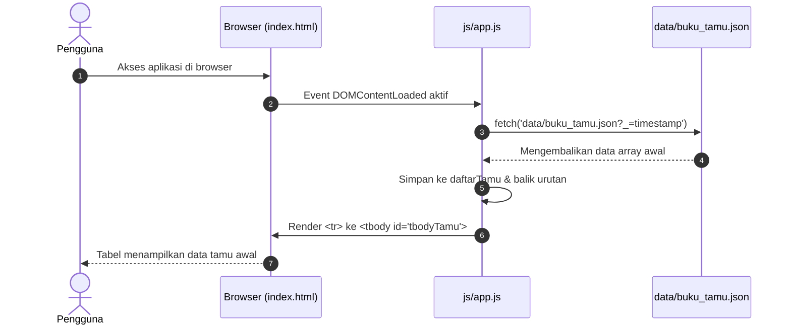
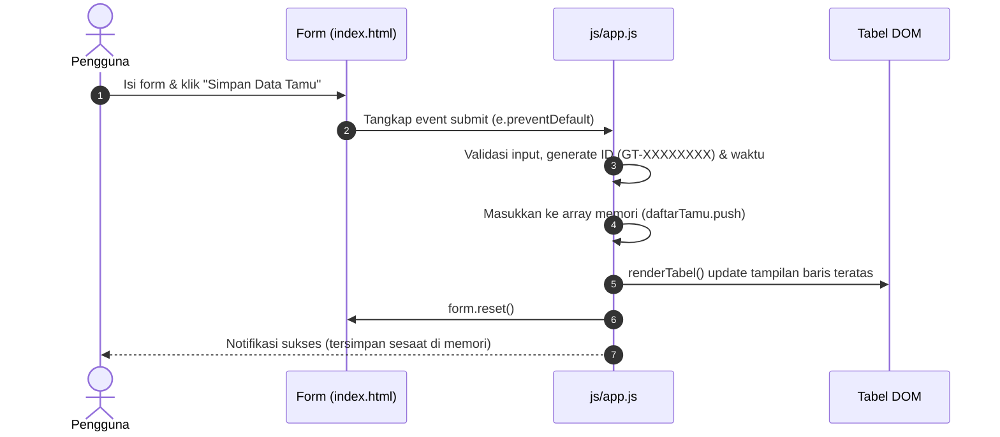

# Dokumentasi Proyek Buku Tamu Sederhana

Proyek ini adalah aplikasi **Buku Tamu Digital** berbasis web *front-end* mandiri yang membaca data awal dari berkas JSON (*flat-file*) dan mengelola entri tamu baru secara langsung di sisi klien (*client-side / in-memory*) tanpa ketergantungan pada backend API eksternal atau database relasional.

---

## 📁 Struktur Direktori & File

```text
buku-tamu/
├── css/
│   └── style.css              # Styling antarmuka (Grid layout, responsif & modern)
├── data/
│   └── buku_tamu.json         # Berkas data awal buku tamu (format JSON)
├── js/
│   └── app.js                 # Logika frontend (fetch data JSON, render tabel, & simpan sesaat)
├── index.html                 # Halaman utama (1 section: Form input + Tabel data)
└── README.md                  # Dokumentasi teknis proyek
```

---

## 1. ⚙️ Penjelasan Penyimpanan & Manajemen Data

Sistem penyimpanan pada versi proyek ini terbagi menjadi dua mekanisme:

1. **Sumber Data Awal (`data/buku_tamu.json`)**:
   * Berkas JSON statis yang bertindak sebagai *initial dataset*.
   * Berisi array objek tamu dengan properti: `id`, `nama`, `instansi`, `keperluan`, dan `waktu`.
   * Dimuat langsung oleh browser saat pertama kali halaman diakses.

2. **Pengelolaan Data Input (Sistem In-Memory / Client-side)**:
   * Pengisian form tamu tidak lagi menggunakan API backend ataupun pustaka `json_store.php`.
   * Setiap data yang diinput oleh pengunjung akan langsung ditampung ke dalam array memori JavaScript (`daftarTamu`).
   * **Penyimpanan Sesaat**: Data baru langsung muncul di tabel secara instan selama sesi aktif halaman browser (bersifat *in-memory* sesaat tanpa disimpan permanen ke server).
   * **Generator ID Mandiri**: ID tamu dibuat langsung di sisi JavaScript dengan format acak unik berawalan `GT-XXXXXXXX`.

---

## 2. 🖥️ Penjelasan Antarmuka (`index.html`)

Tampilan berfokus pada **satu section utama** (`<section class="guestbook-section">`) yang membagi layar menjadi dua kolom berdampingan:

1. **Kolom Kiri (`.form-card`)**:
   * Formulir input dengan 3 isian:
     * `input#nama`: Nama Lengkap pengunjung.
     * `input#instansi`: Asal instansi/organisasi atau umum.
     * `textarea#keperluan`: Alasan atau tujuan berkunjung.
     * `button#btnSubmit`: Tombol pengiriman form.
2. **Kolom Kanan (`.table-card`)**:
   * Menampilkan header ringkasan jumlah tamu (`#totalCount`).
   * Tabel interaktif dengan kolom: **ID Tamu**, **Nama**, **Instansi**, **Keperluan**, dan **Waktu Datang**.
   * Badan tabel (`<tbody id="tbodyTamu">`) dikosongkan pada HTML murni karena baris datanya di-render secara dinamis oleh JavaScript.
3. **Komponen Pendukung**:
   * Kotak notifikasi (`#alertBox`) yang tersembunyi secara default dan muncul otomatis ketika ada status sukses atau peringatan validasi.

---

## 3. 🎨 Penjelasan Styling (`css/style.css`)

CSS dirancang mandiri tanpa framework eksternal, dengan prinsip desain bersih dan modern:

* **Variabel CSS (`:root`)**: Pengelolaan warna tema (palet warna netral *slate/zinc* dipadukan dengan aksen warna biru *royal blue*).
* **Tata Letak Grid (`.guestbook-section`)**:
  * Menggunakan `grid-template-columns: 360px 1fr` sehingga form input memiliki lebar tetap yang ideal, sedangkan tabel data menggunakan sisa ruang layar secara fleksibel.
  * Dilengkapi **Media Query** (`@media (max-width: 850px)`): Otomatis beralih menjadi 1 kolom vertikal (form di atas, tabel di bawah) saat diakses melalui smartphone atau tablet.
* **Komponen Visual**:
  * `.card`: Efek kartu modern dengan *border*, sudut membulat (*border-radius*), dan bayangan lembut (*box-shadow*).
  * `.badge-id`: Format kode ID dengan latar belakang biru muda dan font *monospace* agar terlihat rapi dan formal.
  * `.table-responsive`: Memastikan tabel tidak merusak tata letak pada layar kecil dengan menyediakan scroll horizontal jika diperlukan.

---

## 4. ⚡ Penjelasan Logika JavaScript (`js/app.js`)

Berkas ini mengendalikan seluruh siklus hidup data dan interaktivitas halaman:

### 1. `muatBukuTamu()`
* Mengambil data awal langsung dari `data/buku_tamu.json`.
* Menggunakan parameter *cache-buster* `?_=${new Date().getTime()}` pada URL fetch agar browser selalu membaca versi terbaru berkas JSON.
* Menyimpan array data yang didapat ke variabel global memori `daftarTamu`, lalu memanggil `renderTabel(daftarTamu)`.

### 2. `renderTabel(data)`
* Mengubah array data JavaScript menjadi baris HTML `<tr>` di dalam tabel.
* Menggunakan `[...data].reverse()` agar tamu yang paling baru mendaftar selalu berada di urutan teratas tabel.
* Memperbarui badge counter `#totalCount`.
* Menampilkan *empty state* ramah jika belum ada data.

### 3. `escapeHtml(str)`
* Memberikan perlindungan keamanan terhadap serangan **XSS (Cross-Site Scripting)** dengan mengubah karakter khusus (`<`, `>`, `&`, `"`, `'`) menjadi entitas HTML aman sebelum dimasukkan ke dalam DOM.

### 4. `generateIdTamu()` & `getFormatWaktuSekarang()`
* **`generateIdTamu()`**: Menghasilkan ID unik berbasis hex acak 8 karakter dengan prefix `"GT-"` (contoh: `GT-8F12A09B`).
* **`getFormatWaktuSekarang()`**: Mengembalikan stempel waktu lokal berformat `YYYY-MM-DD HH:mm:ss`.

### 5. `EventListener 'submit' pada Form`
* Menahan reload halaman (`e.preventDefault()`).
* Memvalidasi bahwa seluruh kolom telah terisi.
* Menyusun objek tamu baru dan langsung menambahkannya ke array memori aktif (`daftarTamu.push(dataBaru)`).
* Merender ulang tabel secara seketika (*instant*), mengosongkan form, dan menampilkan notifikasi sukses.

---

## 5. 🔄 Alur Kerja Lengkap (Workflow)

### A. Alur Saat Halaman Pertama Kali Dibuka (Initial Load)



### B. Alur Saat Menambah Tamu Baru (Input $\rightarrow$ Simpan Sesaat $\rightarrow$ Tampil Seketika)


